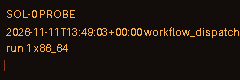

# sol-0-essai

Dépôt d'essai **jetable** pour le projet Sol-0 : il vérifie le workflow planifié, la publication d'images sur une branche `state` et la stabilité des calculs numpy. Il sera supprimé.
*Throwaway test repository for the Sol-0 project.*

